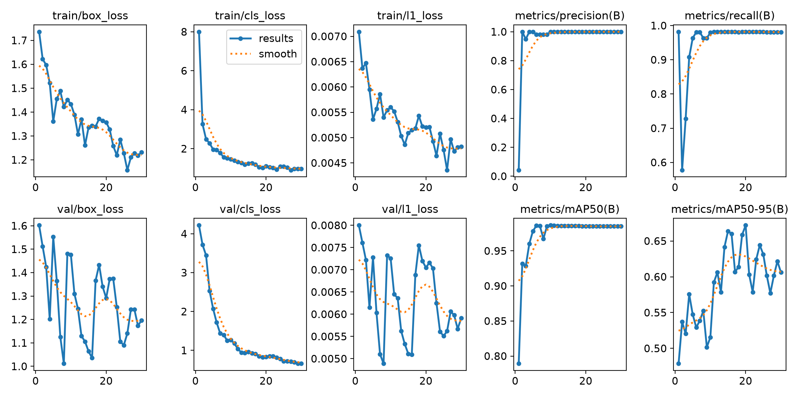
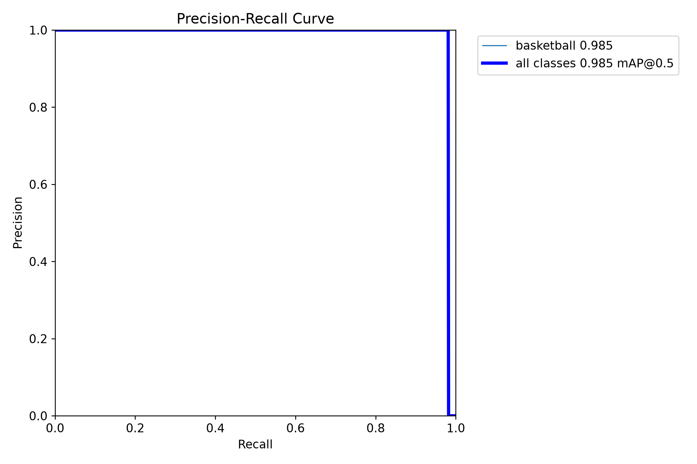

> The Juggling Bounces Challenge, laporan proyek. Bagian ini berdiri sendiri; lihat [README.md](README.md) untuk urutan.

## 2. Data dan Strategi Training

### 2.1 Split berdasarkan waktu, bukan acak

Frame berurutan hampir identik, sehingga split acak menyebabkan kebocoran antara train dan test. Video dibagi per segmen waktu dengan zona penyangga 30 detik yang dibuang:

| Segmen | Waktu (detik) | Peran |
|---|---|---|
| train_01 | 0–600 | train |
| buffer | 600–630 | dibuang |
| val_01 | 630–810 | validasi |
| buffer | 810–840 | dibuang |
| test_01 | 840–1020 | test |
| buffer | 1020–1050 | dibuang |
| train_02 | 1050–1200,1 | train |

Manifest lengkap ada di `data/splits/split_manifest.csv` dengan hash SHA-256 video untuk memastikan sumber data tidak berubah.

### 2.2 Pengambilan dan anotasi frame deteksi

- Frame diambil seragam tiap 10 detik (`uniform_time`), menghasilkan **111 gambar**: train 75, val 18, test 18.
- Anotasi dilakukan di **CVAT** (format YOLO). Penulis meninjau tiap gambar dan setiap kotak kandidat, termasuk gambar tanpa bola, lalu memberi sign-off. Hasil akhir: **336 kotak, satu kelas (`basketball`)**, pasangan gambar dan label valid.
- Tiga frame (val/test) memuat empat kotak. Jumlah saja tidak membuktikan duplikasi, dan tidak ada kotak yang dihapus otomatis.

### 2.3 Fine-tuning (E2)

| Pengaturan | Nilai |
|---|---|
| Model awal | `yolo26n.pt` (pretrained) |
| Optimizer | AdamW, lr0 = 0,001 |
| Epoch maksimum | 50, early stopping patience 10 |
| Batch / ukuran gambar | 8 / 640 |
| Perangkat | CPU, seed 42 |
| Augmentasi | mosaic 1,0; rotasi ±5°; translasi 0,05; skala 0,2; flip horizontal 0,5 |

Training berhenti pada epoch ke-30 karena early stopping, dengan **epoch terbaik 20** (mAP50 0,985; mAP50–95 0,672 pada validasi). Durasi sekitar 596 detik di CPU.

Kurva training dan kurva presisi–recall:

### 2.4 Augmentasi motion blur (E2-blur)

Soal tugas meminta augmentasi motion blur, dan blur gerak memang kandidat penyebab tracker kehilangan bola (Bagian 5). Model E2 di atas dilatih **tanpa** blur khusus, jadi kami melatih model pembanding **E2-blur** setelah hasil E2 diketahui.

- **Cara.** Augmentasi *offline*: untuk tiap dari 75 gambar latih dibuat satu salinan dengan motion blur (kernel garis, panjang acak 9–31 piksel, sudut acak 0–180°, seed 42), sehingga set latih menjadi 150 gambar. Label disalin tanpa perubahan. Validasi dan test tidak diubah. Skrip: `scripts/make_blur_dataset.py`, `scripts/train_e2_blur.py`.
- **Pengaturan lain sama dengan E2** (model awal `yolo26n.pt`, AdamW lr 0,001, batch 8, 640 px, CPU, seed 42, augmentasi bawaan yang sama). Training berhenti di epoch 40 (early stopping), epoch terbaik 30. Bobot: `artifacts/runs/E2_blur_cpu/weights/best.pt`.
- **Keterbatasan.** Blur diterapkan ke seluruh gambar (seperti guncangan kamera), bukan hanya ke bola yang bergerak cepat; ini hanya pendekatan kasar terhadap blur gerak bola. Satu seed, satu proses training.

Hasil pada test split detector (18 gambar, 56 kotak, ultralytics `val`, IoU 0,5):

| Model | Presisi | Recall | AP50 | AP50–95 |
|---|---|---|---|---|
| E2 | 0,999 | 0,964 | 0,977 | 0,678 |
| E2-blur | 0,998 | 0,964 | 0,974 | 0,687 |

Selisihnya jauh di bawah ketidakpastian pada 18 gambar, jadi **tidak ada bukti bahwa blur membantu detector**. Hasil pada hitungan bounce ada di Bagian 6.2. Pipeline akhir tetap memakai E2, karena E2-blur tidak menunjukkan keuntungan.

---
[< 1. Analisis Masalah dan Arsitektur](01_analisis_masalah_dan_arsitektur.md) | [ 3. Anotasi Event Bounce (Ground Truth) >](03_anotasi_event_bounce_ground_truth.md) | [Daftar isi](README.md)
