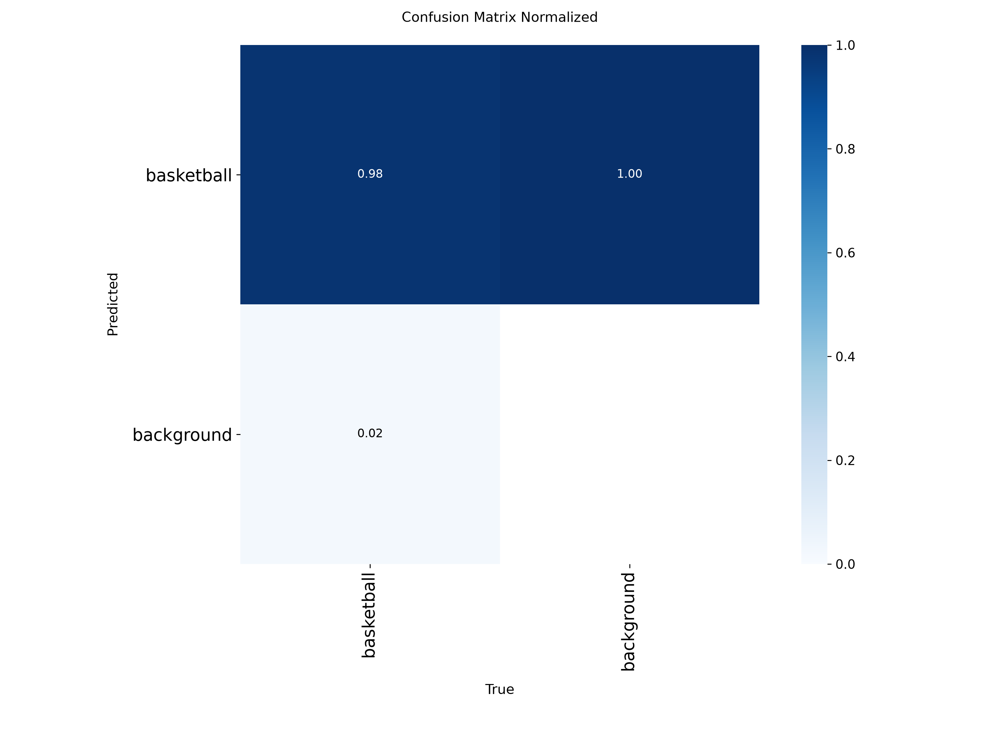

> The Juggling Bounces Challenge, laporan proyek. Bagian ini berdiri sendiri; lihat [README.md](README.md) untuk urutan.

## 4. Eksperimen Detector: E1 vs E2

E1 adalah YOLO26n pretrained tanpa fine-tuning (kelas bola COCO dipetakan ke kelas `basketball`). E2 adalah hasil fine-tuning. Evaluasi pada set test yang identik (18 gambar, 56 kotak), IoU 0,5, ambang confidence dipilih hanya dari validasi lalu dibekukan sebelum menyentuh test.

| Model | Ambang | Presisi | Recall | F1 | TP / FP / FN | AP50 | mAP50–95 |
|---|---|---|---|---|---|---|---|
| E1 (pretrained) | 0,05 | 0,815 | 0,786 | 0,800 | 44 / 10 / 12 | 0,821 | 0,612 |
| **E2 (fine-tuned)** | 0,45 | **1,000** | **0,964** | **0,982** | 54 / 0 / 2 | **0,964** | **0,666** |

Fine-tuning pada hanya 75 gambar latih sudah menghilangkan seluruh false positive di set test. Catatan: set test kecil (18 gambar), sehingga angka ini menunjukkan arah, bukan estimasi presisi tinggi.

---
[< 3. Anotasi Event Bounce (Ground Truth)](03_anotasi_event_bounce_ground_truth.md) | [ 5. Rekayasa Pipeline: dari Deteksi ke Hitungan >](05_rekayasa_pipeline_dari_deteksi_ke_hitungan.md) | [Daftar isi](README.md)
