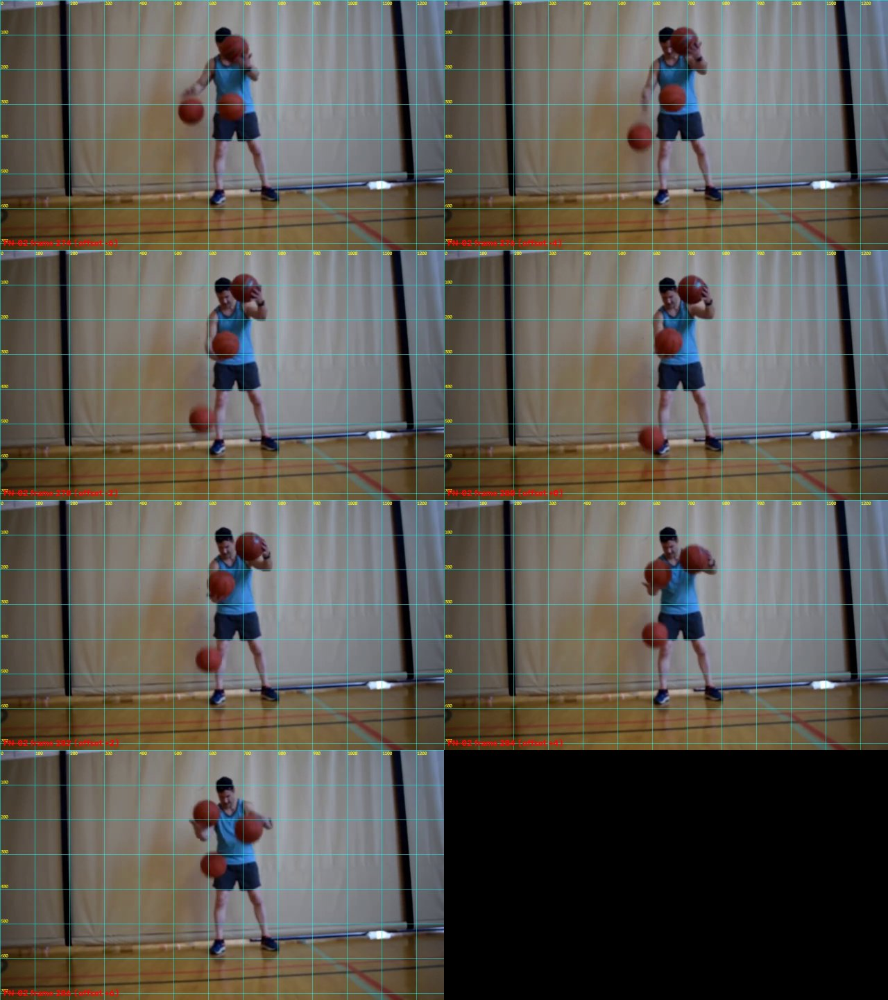

> The Juggling Bounces Challenge, laporan proyek. Bagian ini berdiri sendiri; lihat [README.md](README.md) untuk urutan.

## 5. Rekayasa Pipeline: dari Deteksi ke Hitungan

Bagian ini inti proyek: bagaimana keluaran detector diubah menjadi hitungan bounce, termasuk tiga iterasi dan pelajaran dari kesalahan diagnosis.

### 5.1 Iterasi 1 — E2 + ByteTrack + aturan lantai

Detector E2 dijalankan dengan ByteTrack. Sebuah bounce dinyatakan terjadi jika bola turun, lalu naik, dengan sisi bawah kotak berada di zona lantai (bagian bawah frame, ambang 0,75 tinggi frame).

Pada 60 detik pertama (GT v2, 126 event): **19 prediksi, semuanya benar, 107 terlewat**. Presisi 1,00 tetapi recall hanya **0,15** (F1 0,26).

### 5.2 Iterasi 2 — Aturan gerak murni (E3)

Kami menghilangkan syarat zona lantai dan mendeteksi pembalikan arah gerak vertikal pada lintasan ByteTrack. E3-A menghasilkan 265 prediksi, E3-B (dengan batas adaptif) 210. Pada GT v2: E3-B menemukan 28 dari 126 dengan **182 false positive** (presisi 0,13, recall 0,22, F1 0,17). Bola yang dipegang atau dipantulkan di tangan juga membalik arah, sehingga banyak event palsu.

### 5.3 Mencari penyebab — dan dua dugaan yang keliru

Dua penjelasan awal ternyata tidak terbukti:

1. **Analisis heuristik** menyimpulkan 105 dari 107 miss disebabkan "fragmentasi ID tracker". Itu hanya berdasarkan jumlah ID dan kehadiran track, bukan pengamatan visual.
2. **Review visual awal** (dibantu AI) pada 20 klip miss menduga "detector dropout" di 10 kasus. Itu hanya memeriksa satu frame tengah dan tidak membedakan bola mana yang memantul.

Pemeriksaan ulang yang lebih ketat:

- **Deteksi mentah** (conf 0,05) pada 126 frame GT ±6 frame menunjukkan detector **menembak** di sekitar 105 dari 107 miss. Jadi detector bukan akar masalah utama.
- Setiap frame berisi dua sampai tiga bola. Kotak di dekat waktu GT bisa milik bola lain, sehingga "ada kotak" tidak membuktikan bola kontak terlacak. Banyaknya ID track juga bukan bukti pertukaran ID.
- Kami lalu menandai **titik kontak per bola** pada tujuh kasus (FN-02, 03, 04, 08, 12, 14, 20). Pada ketujuhnya bola yang memantul adalah bola terbawah di dekat kaki, dan paling rendah tepat di frame GT, jadi **timing GT terbukti benar**.
- Pada tujuh kasus itu, detector melihat bola kontak pada sekitar 31 frame-bola (confidence ≥ 0,25), tetapi **keluaran tracker hanya memuat 9** di antaranya. Tiga kasus tidak memuat satu pun kotak di sekitar kontak.
- Kasus yang tadinya tampak gagal karena "zona lantai" (FN-14, FN-20) ternyata sama: titik kontaknya sekitar 0,77 tinggi frame, tetapi tracker tidak mengeluarkan frame terbawah.



**Kesimpulan diagnosis:** bola bergerak cepat dan blur antar frame sehingga IoU antar kotak yang berurutan kecil atau nol. ByteTrack gagal menyambungnya dan membuang deteksi, sehingga lintasan terpotong tepat di sekitar kontak dan aturan "turun lalu naik" tidak pernah terpenuhi.

Catatan kejujuran: titik kontak pada tujuh kasus itu diusulkan AI dari gambar dan **belum diverifikasi manusia**, sehingga ini hipotesis kuat dari sampel kecil. Hipotesis itu kemudian diuji langsung oleh hasil pada Bagian 5.4 dan 6.

### 5.4 Iterasi 3 — Asosiasi berbasis jarak pada deteksi mentah

Mengganti IoU dengan jarak posisi, dan memakai deteksi mentah (confidence ≥ 0,25 disimpan, ≥ 0,3 dipakai tracking).

**Asosiasi.** Tiap lintasan punya prediksi posisi berkecepatan konstan. Deteksi dicocokkan secara serakah (jarak terdekat dulu) jika jaraknya ≤ gate × ukuran kotak, dengan gate yang melonggar saat lintasan kehilangan frame:

```
jarak(d, track) <= gate * max(ukuran_track, ukuran_d) * (1 + 0,25 * (jeda - 1))
gate = 1,5 ; jeda maksimum = 4 frame
```

**Deteksi event.** Pada lintasan dengan sekurangnya lima titik, titik ke-i dinyatakan bounce jika:

1. sisi bawah kotak ≥ 0,65 × tinggi frame (dekat lantai; ini yang menolak bola yang dipegang atau ditangkap di tangan),
2. dalam jendela ±5 frame, posisi vertikal turun ≥ 15 piksel sebelum titik itu dan naik ≥ 15 piksel sesudahnya,
3. titik itu adalah posisi vertikal terendah (maksimum koordinat y) dalam jendela,
4. event dalam 0,2 detik dari event lain pada lintasan yang sama digabung (diambil yang terendah).

**Protokol evaluasi yang adil.** Parameter dicari dengan grid 54 konfigurasi (gate, ambang lantai, minimum turun/naik, jeda maksimum) **hanya pada detik 0–30 (dev)**. Detik 30–60 (holdout) dievaluasi sekali. Hasilnya: seluruh 54 konfigurasi memberi F1 dev yang sama (0,98), sehingga hasilnya tidak sensitif terhadap pilihan parameter. Parameter terpilih: gate 1,5; lantai 0,65; minimum 15 piksel; jeda maksimum 4.


---
[< 4. Eksperimen Detector: E1 vs E2](04_eksperimen_detector_e1_vs_e2.md) | [ 6. Hasil Kuantitatif >](06_hasil_kuantitatif.md) | [Daftar isi](README.md)
