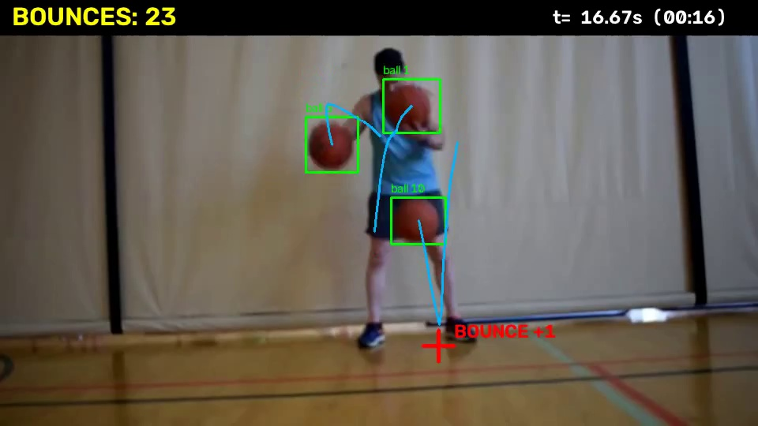

> The Juggling Bounces Challenge, laporan proyek. Bagian ini berdiri sendiri; lihat [README.md](README.md) untuk urutan.

## 6. Hasil Kuantitatif

### 6.1 Pada ground truth (0–60 detik, GT v2, toleransi ±0,1 detik)

| Segmen | Metode | Prediksi | TP | FP | FN | Presisi | Recall | F1 |
|---|---|---|---|---|---|---|---|---|
| Dev 0–30 s (56 GT) | **Asosiasi jarak (akhir)** | 54 | 54 | 0 | 2 | 1,00 | 0,96 | **0,98** |
| | E2 + ByteTrack | 8 | 8 | 0 | 48 | 1,00 | 0,14 | 0,25 |
| | E3-B | 91 | 13 | 78 | 43 | 0,14 | 0,23 | 0,18 |
| Holdout 30–60 s (70 GT) | **Asosiasi jarak (akhir)** | 70 | 70 | 0 | 0 | 1,00 | 1,00 | **1,00** |
| | E2 + ByteTrack | 11 | 11 | 0 | 59 | 1,00 | 0,16 | 0,27 |
| | E3-B | 119 | 15 | 104 | 55 | 0,13 | 0,21 | 0,16 |

Untuk 60 detik penuh: 124 prediksi vs 126 GT, **kesalahan hitungan absolut (APE) 1,6%**; 124 TP, 0 FP, 2 FN; galat waktu rata-rata 0,53 frame.

### 6.2 Dua segmen tambahan di video penuh (GT manual, parameter dibekukan)

Dua segmen 60 detik dianotasi manual di luar 0–60 detik, lalu dibandingkan dengan keluaran metode akhir (parameter beku, tanpa tuning ulang), toleransi ±0,1 detik (3 frame).

| Segmen | GT | Prediksi | Tahap | TP | FP | FN | Presisi | Recall | F1 | APE |
|---|---|---|---|---|---|---|---|---|---|---|
| 300–360 s | 135 | 135 | GT asli | 133 | 2 | 2 | 0,985 | 0,985 | 0,985 | 0% |
| | 135 | 135 | Setelah koreksi GT | 135 | 0 | 0 | 1,000 | 1,000 | 1,000 | 0% |
| 900–960 s | 135 | 135 | GT asli | 133 | 2 | 2 | 0,985 | 0,985 | 0,985 | 0% |
| | 135 | 135 | Setelah koreksi GT | 135 | 0 | 0 | 1,000 | 1,000 | 1,000 | 0% |

Cara membaca:
- Baris "GT asli" adalah ukuran yang lebih jujur. Baris "setelah koreksi" adalah batas atas, karena empat event dikoreksi setelah melihat prediksi dan frame koreksinya sama dengan frame prediksi.
- APE 0% tidak berarti tanpa kesalahan; pada baris GT asli, 2 FP dan 2 FN saling meniadakan. Selalu baca bersama TP/FP/FN.
- Sebuah bug pembulatan di skrip evaluasi (selisih tepat 3 frame ditolak akibat galat float, 0,1000000000000x > 0,1) sempat menambah dua pasang FP/FN palsu di segmen 900–960; sudah diperbaiki dengan margin 1e-6. Angka di tabel adalah angka setelah perbaikan itu.
- **Detector dan segmen ini.** Segmen 300–360 s berada di dalam rentang `train_01` (0–600 s) detector, dengan sekitar enam gambar latih (sampling tiap 10 detik) di dalamnya. Segmen 900–960 s berada di rentang `test_01` (840–1020 s), yang tidak dipakai melatih detector. Jadi hanya 900–960 s yang benar-benar tidak terlihat oleh detector; 300–360 s tidak terlihat oleh penyetelan parameter event, tetapi tidak oleh detector.
- **E2-blur (Bagian 2.4) pada segmen yang sama**, parameter dan metode identik, hanya bobot detector diganti:

| Segmen | GT | Model | TP | FP | FN | F1 |
|---|---|---|---|---|---|---|
| 300–360 s, GT asli | 135 | E2 | 133 | 2 | 2 | 0,985 |
| | | E2-blur | 133 | 1 | 2 | 0,989 |
| 300–360 s, GT dikoreksi | 135 | E2 | 135 | 0 | 0 | 1,000 |
| | | E2-blur | 134 | 0 | 1 | 0,996 |
| 900–960 s, GT asli | 135 | E2 | 133 | 2 | 2 | 0,985 |
| | | E2-blur | 133 | 2 | 2 | 0,985 |
| 900–960 s, GT dikoreksi | 135 | E2 | 135 | 0 | 0 | 1,000 |
| | | E2-blur | 135 | 0 | 0 | 1,000 |

  Pada 900–960 s kedua model memberi event yang sama persis. Satu-satunya perbedaan ada di sekitar 313,2–313,5 s (segmen 300–360): E2-blur mengeluarkan satu event di tempat E2 mengeluarkan dua, yang menurut penilaian penulis adalah dua bounce. Dengan GT dikoreksi itu terhitung satu FN untuk E2-blur. Karena koreksi GT diambil dari frame prediksi **E2**, perbandingan dengan GT dikoreksi condong ke E2; perbandingan dengan GT asli lebih adil, dan di sana selisihnya hanya satu FP. Kesimpulan: **motion blur tidak memberi perbedaan yang dapat dibuktikan pada hitungan bounce**, dan perbedaan sekecil satu event tidak dapat dibedakan dari kebisingan.
- Total 270 event terverifikasi dari dua segmen, satu video, satu kamera, satu penganotasi, tanpa pemeriksaan kedua.

### 6.3 Seluruh video 20 menit (tanpa GT penuh)

Parameter dibekukan dari dev, lalu dijalankan pada 36.003 frame. Total **2.685 bounce**:

| Menit | 1 | 2 | 3 | 4 | 5 | 6 | 7 | 8 | 9 | 10 |
|---|---|---|---|---|---|---|---|---|---|---|
| Bounce | 124 | 139 | 137 | 134 | 134 | 135 | 135 | 135 | 133 | 133 |

| Menit | 11 | 12 | 13 | 14 | 15 | 16 | 17 | 18 | 19 | 20 |
|---|---|---|---|---|---|---|---|---|---|---|
| Bounce | 136 | 136 | 134 | 134 | 133 | 135 | 136 | 133 | 133 | 136 |

Jumlah per menit stabil (124–139) dan sejalan dengan GT v2 menit pertama (126). Ini pemeriksaan konsistensi, **bukan** ukuran akurasi.

### 6.4 Verifikasi buta oleh manusia (menit 2–20)

Tanpa GT di luar menit pertama, kami membuat 30 klip pendek diacak, tanpa kotak model, dengan bingkai merah di frame target. Penulis menjawab "ada", "tidak", atau "ragu" lewat antarmuka klik, tanpa mengetahui mana klip prediksi dan mana klip kontrol.

| Kelompok klip | Jawaban | Arti |
|---|---|---|
| 20 klip di bounce yang diklaim | 20 "ada", 0 "tidak" | Presisi 20/20 |
| 10 klip di waktu acak tanpa klaim (≥ 0,25 detik dari prediksi) | 8 "tidak", 2 "ada" | Ada bounce yang terlewat |

Dengan sampel 20, batas bawah presisi (kepercayaan 95%) sekitar 0,84. Dua bounce terlewat ada di sekitar detik 751,9 dan 989,1. Recall tidak dapat dihitung dari sampel ini.

### 6.5 Video akhir

Video beranotasi untuk seluruh 20 menit: `artifacts/runs/Phase4_bridging/final_video_20min.mp4` (960×540, 30 fps). Isinya kotak bola dan ID, jejak lintasan, penanda "BOUNCE +1" di titik kontak, penghitung kumulatif, dan waktu. Hitungan akhir pada frame terakhir: **2.685**.

---
[< 5. Rekayasa Pipeline: dari Deteksi ke Hitungan](05_rekayasa_pipeline_dari_deteksi_ke_hitungan.md) | [ 7. Analisis Kegagalan >](07_analisis_kegagalan.md) | [Daftar isi](README.md)
