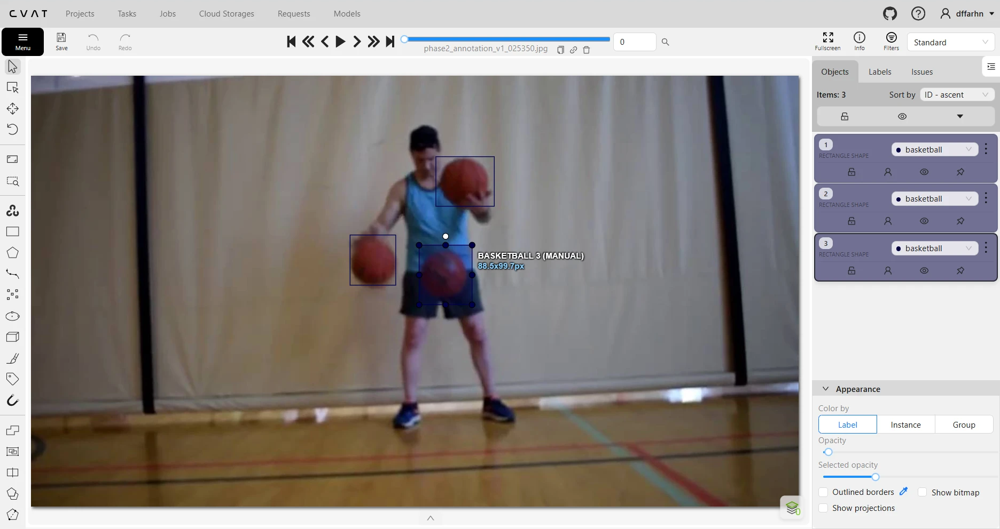
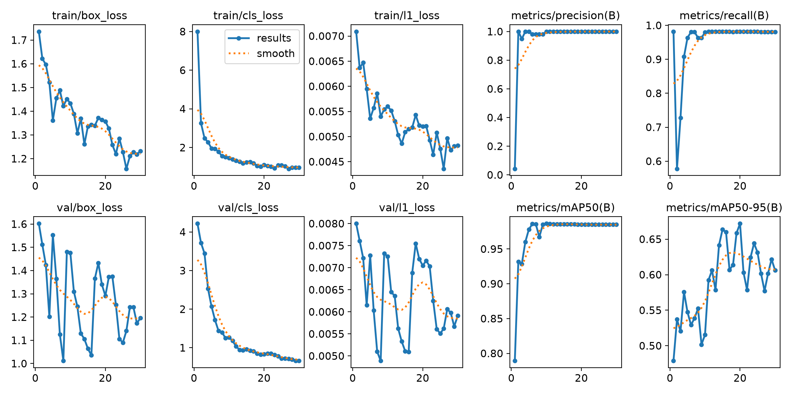
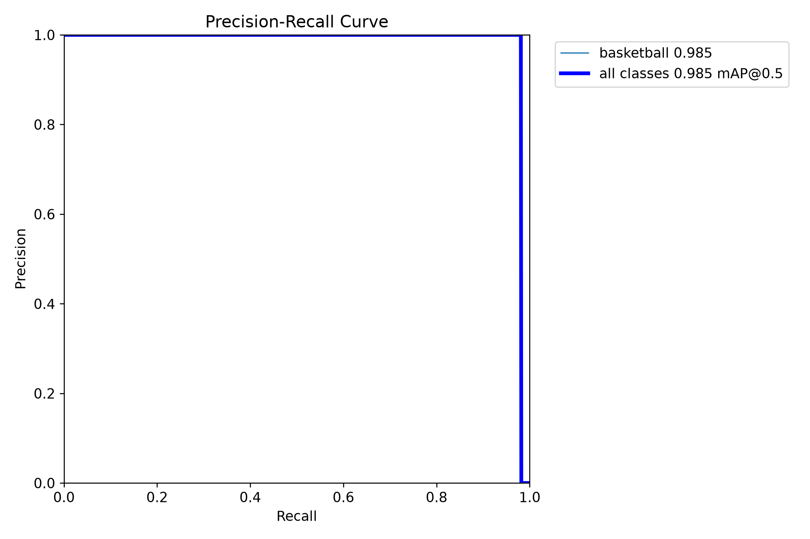
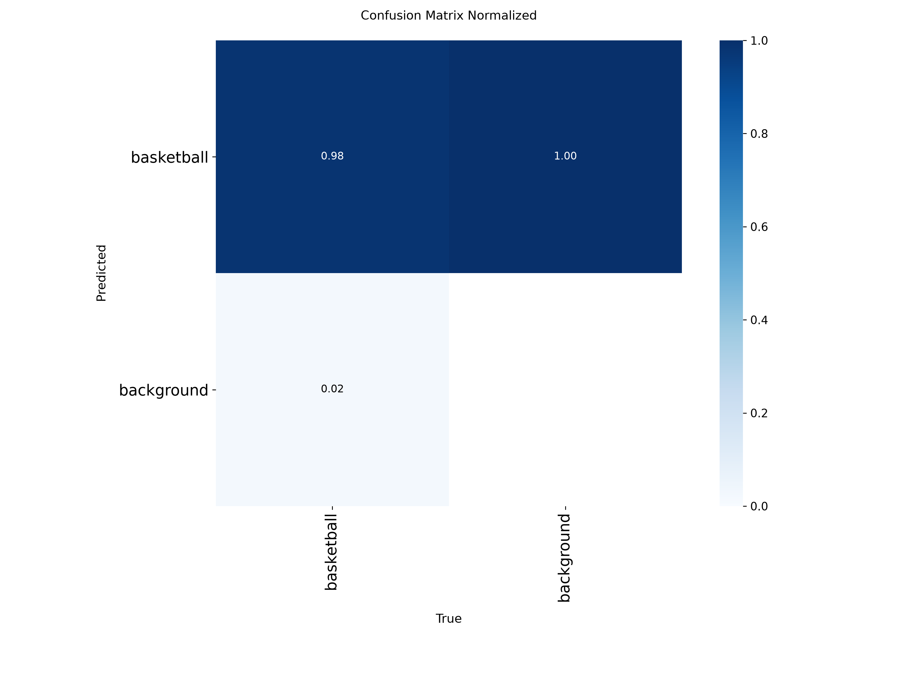
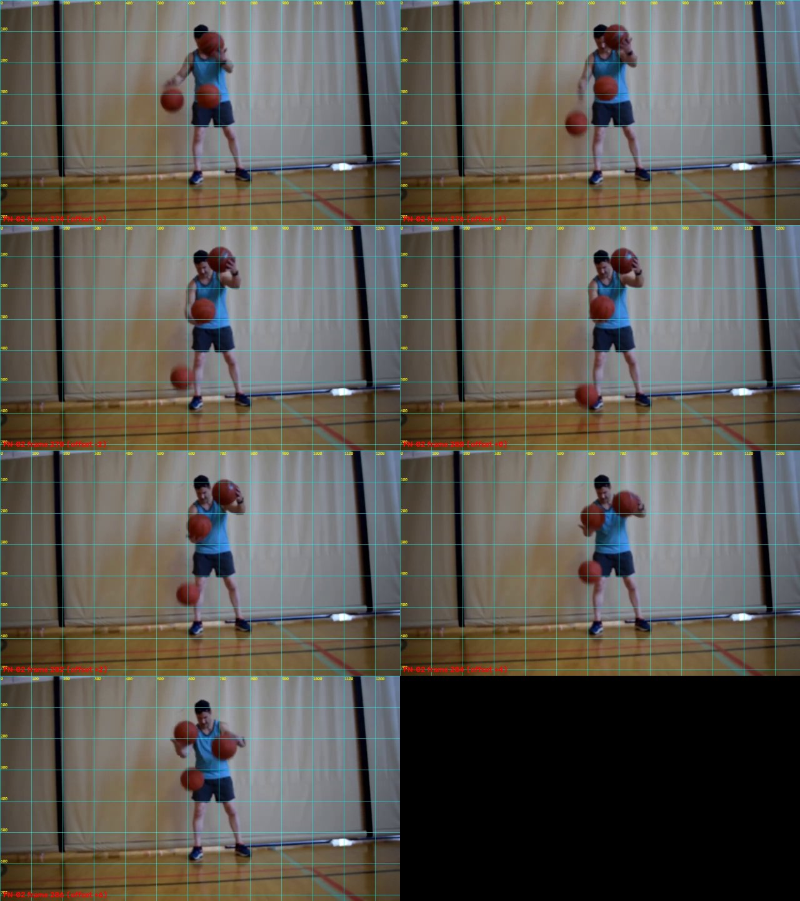
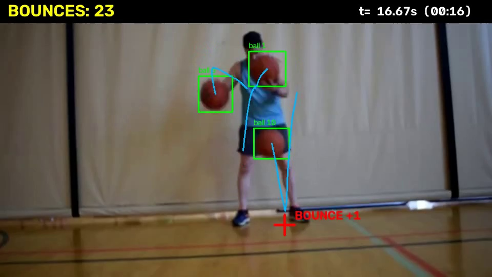

# 1. Ringkasan Eksekutif

Tugas ini meminta sebuah pipeline deep learning yang menghitung berapa kali bola basket menyentuh lantai pada video seorang pria yang menjuggling tiga bola. Kami menguraikan masalah menjadi tiga tahap, yaitu **lokalisasi bola** (detector YOLO26n yang di-fine-tune), **tracking** (asosiasi deteksi antar frame berbasis jarak), dan **deteksi event temporal** (aturan titik terendah lintasan di zona lantai).

<div class="stats">
<div><b>0,98</b><span>F1 detector (test, E2) vs 0,80 pretrained</span></div>
<div><b>0,985–1,00</b><span>F1 event pada 270 event GT manual di 2 segmen baru</span></div>
<div><b>70 / 70</b><span>bounce benar pada holdout 30–60 s, 0 false positive</span></div>
<div><b>0,44%</b><span>APE hitungan seluruh video: 2.685 vs 2.697 GT manual</span></div>
</div>

Temuan utama:

- **Detector.** Fine-tuning pada 111 gambar yang kami anotasi sendiri menaikkan F1 pada set test dari 0,80 (pretrained) menjadi 0,98.
- **Tracking adalah hambatan utama, bukan detector.** Kombinasi E2 + ByteTrack hanya menemukan 19 dari 126 bounce pada 60 detik pertama (recall 0,15). Detector sebenarnya melihat bola yang menyentuh lantai, tetapi tracker berbasis IoU membuang sebagian besar deteksi itu karena bola bergerak cepat dan blur.
- **Perbaikan.** Asosiasi berdasarkan jarak posisi pada deteksi mentah, ditambah aturan titik terendah lintasan. Dengan parameter yang dipilih hanya dari detik 0–30, hasilnya 70 dari 70 bounce benar pada detik 30–60 tanpa false positive.
- **Validasi tambahan.** Pada dua segmen 60 detik di tengah dan akhir video (300–360 s dan 900–960 s; 135 event manual masing-masing), parameter beku memberi F1 0,985 terhadap GT asli dan 1,00 setelah koreksi GT. Skor 1,00 adalah batas atas, bukan perkiraan akurasi (Bagian 6.3 dan 8).
- **Seluruh video dibandingkan dengan GT manual.** Pipeline menghitung **2.685 bounce** pada 20 menit. Ground truth manual seluruh video berisi 2.702 tanda; setelah penganotasi mengoreksi 5 tanda berlebih, total acuannya **2.697**. Selisih −12, **APE 0,44%** (0,63% terhadap 2.702 tanda mentah). Selisih per menit paling besar 3 bounce, dan pipeline cenderung menghitung sedikit kurang (14 dari 20 menit). Verifikasi buta terpisah: 20 dari 20 bounce yang diklaim benar.
- **Augmentasi motion blur.** Model pembanding E2-blur tidak memberi perbedaan yang dapat dibuktikan; model akhir tetap E2 (Bagian 3.4).

> **Batasan yang perlu dibaca bersama angka di atas.** Semua hasil berasal dari satu video, satu kamera, dan satu penganotasi. Ground truth seluruh video ditandai satu orang secara langsung dan belum diperiksa orang kedua; selisih total acuan (2.702 vs 2.697) menunjukkan ketidakpastian GT sendiri sekitar ±0,2%. Akurasi 100% tidak dapat diklaim, dan angka F1 per event hanya perkiraan (Bagian 6.5 dan 8).

## 1.1 Alur kerja dan lokasi buktinya

| No. | Isi | Bagian | Bukti |
|---|---|---|---|
| 1 | Analisis masalah, pemilihan model | 2 | — |
| 2 | Split berdasarkan waktu, anotasi 111 gambar (CVAT) | 3.1, 3.2 | `data/splits/`, `data/cvat_phase2_reviewed/` |
| 3 | Baseline pretrained (E1) | 4 | `artifacts/runs/E1_20261016_0025/` |
| 4 | Fine-tuning (E2) dan model E2-blur | 3.3, 3.4 | `artifacts/runs/E2_finetuned_cpu/`, `E2_blur_cpu/` |
| 5 | Iterasi pipeline: ByteTrack, gerak murni, asosiasi jarak | 5 | `artifacts/runs/Phase4_*` |
| 6 | Ground truth bounce manual (seluruh video, plus segmen 0–60, 300–360, 900–960 s) | 6.1 | `data/annotations/gt_full_video.csv`, `gt_segment_*.csv` |
| 7 | Evaluasi kuantitatif dan analisis kegagalan | 6, 7 | `artifacts/runs/Phase5_gt_eval/`, `Phase5_full_gt_eval/` |
| 8 | Hitungan seluruh video dan verifikasi buta | 6.5, 6.6 | `artifacts/runs/Phase4_bridging/` |
| 9 | Video demonstrasi | 6.8 | `artifacts/runs/Phase4_bridging/final_video_20min.mp4` |

# 2. Definisi Masalah dan Arsitektur

## 2.1 Definisi masalah

- **Input:** satu video (`videofull.mp4`), 1280×720, 30 fps, 36.003 frame (1.200,1 detik), H.264. Seorang pria menjuggling tiga bola; tiap frame berisi dua sampai tiga bola. Kamera tetap.
- **Output:** jumlah total sentuhan bola ke lantai, beserta waktu tiap event.
- **Definisi event:** satu event adalah satu momen saat salah satu bola menyentuh lantai. Bola yang ditangkap atau dipantulkan di tangan bukan event.

## 2.2 Dekomposisi

| Tahap | Pertanyaan | Keluaran |
|---|---|---|
| Lokalisasi | Di mana bola di tiap frame? | Kotak per bola dan confidence |
| Tracking | Kotak mana yang bola yang sama antar frame? | Lintasan per bola |
| Deteksi event | Kapan sebuah lintasan menyentuh lantai? | Waktu dan frame event |

Detector saja tidak menghitung bounce. Bounce adalah pola temporal pada lintasan: turun, kontak, lalu naik.

## 2.3 Pemilihan model dan trade-off

- **YOLO26n sebagai detector.** Bobot pretrained tersedia, fine-tuning sederhana, keluarannya langsung kotak, dan ringan untuk CPU (sekitar 60–70 ms per gambar pada pengukuran validasi kami). Model yang lebih besar mungkin lebih akurat, tetapi detector sudah mencapai F1 0,98 setelah fine-tuning, sehingga biaya tambahan tidak dibenarkan.
- **Mengapa bukan model temporal end-to-end** (misalnya TCN atau video transformer): data berlabel waktu kami terbatas (126 event pada GT 0–60 detik), sedangkan aturan gerak berbasis lintasan transparan dan dapat diaudit per event. Setiap keputusan dapat ditelusuri ke frame tertentu.
- **ByteTrack** dipakai pada tahap awal karena terintegrasi dengan Ultralytics dan memanfaatkan deteksi berconfidence rendah. Kelemahannya baru terlihat kemudian (Bagian 5).

## 2.4 Arsitektur akhir

<div class="flow">
<div><b>Video</b><span>videofull.mp4<br>indeks frame = waktu × 30</span></div>
<div class="arrow">→</div>
<div><b>Detector</b><span>YOLO26n fine-tuned (E2)<br>confidence ≥ 0,25</span></div>
<div class="arrow">→</div>
<div><b>Asosiasi</b><span>berbasis jarak pada deteksi mentah<br>(pengganti IoU)</span></div>
<div class="arrow">→</div>
<div><b>Event</b><span>titik terendah lintasan<br>turun lalu naik, dekat lantai</span></div>
<div class="arrow">→</div>
<div><b>Keluaran</b><span>events.csv<br>video beranotasi</span></div>
</div>

# 3. Data dan Strategi Training

## 3.1 Split berdasarkan waktu, bukan acak

Frame yang berurutan hampir identik, sehingga split acak menyebabkan kebocoran antara train dan test. Video dibagi per segmen waktu dengan zona penyangga 30 detik yang dibuang:

| Segmen | Waktu (detik) | Peran |
|---|---|---|
| train_01 | 0–600 | train |
| buffer | 600–630 | dibuang |
| val_01 | 630–810 | validasi |
| buffer | 810–840 | dibuang |
| test_01 | 840–1020 | test |
| buffer | 1020–1050 | dibuang |
| train_02 | 1050–1200,1 | train |

Manifes lengkap ada di `data/splits/split_manifest.csv`, disertai hash SHA-256 video untuk memastikan sumber data tidak berubah.

## 3.2 Pengambilan dan anotasi frame deteksi

- Frame diambil seragam tiap 10 detik, menghasilkan **111 gambar**: train 75, val 18, test 18.
- Anotasi dilakukan di **CVAT** (format YOLO). Kami meninjau tiap gambar dan setiap kotak kandidat, termasuk gambar tanpa bola, lalu memberi sign-off. Hasil akhir: **336 kotak, satu kelas (`basketball`)**, dengan pasangan gambar dan label yang valid.
- Tiga frame (val/test) memuat empat kotak. Jumlah saja tidak membuktikan duplikasi, dan tidak ada kotak yang dihapus otomatis.

Bukti bahwa anotasi dikerjakan di CVAT: isi database instance CVAT lokal (Docker, `cvat/server`) pada 10 November 2026 sesuai dengan angka di atas.

| Task CVAT | Peran | Gambar | Kotak berlabel |
|---|---|---|---|
| Phase 2 Human Review | train | 75 | 225 |
| Val-Task-review-basketball | validasi | 18 | 55 |
| test-bouncing-ball | test | 18 | 56 |
| **Total** | | **111** | **336** (semua kelas `basketball`) |

Ketiga task dibuat pada 16 Oktober 2026. Jumlah kotak pada task validasi (55) dan test (56) sama dengan jumlah ground truth yang dipakai pada evaluasi detector.



## 3.3 Fine-tuning (E2)

| Pengaturan | Nilai |
|---|---|
| Model awal | `yolo26n.pt` (pretrained) |
| Optimizer | AdamW, lr0 = 0,001 |
| Epoch maksimum | 50, early stopping patience 10 |
| Batch / ukuran gambar | 8 / 640 |
| Perangkat | CPU, seed 42 |
| Augmentasi | mosaic 1,0; rotasi ±5°; translasi 0,05; skala 0,2; flip horizontal 0,5 |

Training berhenti pada epoch ke-30 karena early stopping, dengan **epoch terbaik 20** (mAP50 0,985; mAP50–95 0,672 pada validasi). Durasi sekitar 596 detik di CPU.





## 3.4 Augmentasi motion blur (E2-blur)

Soal tugas meminta augmentasi motion blur, dan blur gerak memang kandidat penyebab tracker kehilangan bola (Bagian 5). Model E2 dilatih tanpa blur khusus, sehingga kami melatih model pembanding **E2-blur**.

- **Cara.** Augmentasi *offline*: untuk setiap dari 75 gambar latih dibuat satu salinan dengan motion blur (kernel garis, panjang acak 9–31 piksel, sudut acak 0–180°, seed 42), sehingga set latih menjadi 150 gambar. Label disalin tanpa perubahan. Validasi dan test tidak diubah.
- **Pengaturan lain identik dengan E2.** Training berhenti di epoch 40 (early stopping), epoch terbaik 30.
- **Keterbatasan.** Blur dikenakan ke seluruh gambar (menyerupai guncangan kamera), bukan hanya pada bola yang bergerak cepat; ini pendekatan kasar. Satu seed, satu proses training.

Hasil pada test split detector (18 gambar, 56 kotak, `ultralytics val`, IoU 0,5):

| Model | Presisi | Recall | AP50 | AP50–95 |
|---|---|---|---|---|
| E2 | 0,999 | 0,964 | 0,977 | 0,678 |
| E2-blur | 0,998 | 0,964 | 0,974 | 0,687 |

Selisihnya jauh di bawah ketidakpastian pada 18 gambar, sehingga **tidak ada bukti bahwa blur membantu detector**. Hasil pada hitungan bounce ada di Bagian 6.4. Pipeline akhir tetap memakai E2 karena E2-blur tidak menunjukkan keuntungan.

# 4. Evaluasi Detector

E1 adalah YOLO26n pretrained tanpa fine-tuning (kelas bola COCO dipetakan ke kelas `basketball`). E2 adalah hasil fine-tuning. Evaluasi memakai set test yang identik (18 gambar, 56 kotak), IoU 0,5. Ambang confidence dipilih hanya dari validasi, lalu dibekukan sebelum menyentuh test.

| Model | Ambang | Presisi | Recall | F1 | TP / FP / FN | AP50 | mAP50–95 |
|---|---|---|---|---|---|---|---|
| E1 (pretrained) | 0,05 | 0,815 | 0,786 | 0,800 | 44 / 10 / 12 | 0,821 | 0,612 |
| **E2 (fine-tuned)** | 0,45 | **1,000** | **0,964** | **0,982** | 54 / 0 / 2 | **0,964** | **0,666** |

Fine-tuning pada hanya 75 gambar latih sudah menghilangkan seluruh false positive pada set test. Set test kecil (18 gambar), sehingga angka ini menunjukkan arah, bukan estimasi presisi yang tinggi. Angka AP di tabel ini dihitung dengan skrip evaluasi kami (confidence 0,001); angka di Bagian 3.4 memakai `ultralytics val`, sehingga keduanya tidak untuk dibandingkan langsung.



# 5. Rekayasa Pipeline: dari Deteksi ke Hitungan

Bagian ini adalah inti proyek: bagaimana keluaran detector diubah menjadi hitungan bounce. Kami melalui tiga iterasi, dan pelajaran terpenting justru datang dari diagnosis yang keliru.

## 5.1 Iterasi 1: E2 + ByteTrack + aturan zona lantai

Detector E2 dijalankan dengan ByteTrack. Sebuah bounce dinyatakan terjadi jika bola turun lalu naik, dengan sisi bawah kotak berada di zona lantai (ambang 0,75 tinggi frame). Pada 60 detik pertama (126 event GT): **19 prediksi, semuanya benar, 107 terlewat**. Presisi 1,00 tetapi recall hanya **0,15** (F1 0,26).

## 5.2 Iterasi 2: aturan gerak murni (E3)

Syarat zona lantai dihilangkan, dan pembalikan arah gerak vertikal pada lintasan ByteTrack dipakai sebagai penanda bounce. E3-A menghasilkan 265 prediksi, E3-B (dengan batas adaptif) 210. Pada GT 126 event, E3-B menemukan 28 dengan **182 false positive** (presisi 0,13, recall 0,22, F1 0,17). Bola yang dipegang atau dipantulkan di tangan juga membalik arah, sehingga banyak event palsu.

## 5.3 Diagnosis penyebab

Dua penjelasan awal ternyata tidak terbukti:

1. **Analisis heuristik** menyimpulkan 105 dari 107 miss disebabkan "fragmentasi ID tracker". Kesimpulan itu hanya berdasar jumlah ID dan kehadiran track, bukan pengamatan visual.
2. **Review visual awal** (dibantu AI) pada 20 klip miss menduga "detector dropout" pada 10 kasus. Review itu hanya memeriksa satu frame tengah dan tidak membedakan bola mana yang memantul.

Pemeriksaan ulang yang lebih ketat:

- **Deteksi mentah** (confidence 0,05) pada 126 frame GT ±6 frame menunjukkan detector **menembak** di sekitar 105 dari 107 miss. Jadi detector bukan akar masalah utama.
- Setiap frame berisi dua sampai tiga bola. Kotak di dekat waktu GT bisa milik bola lain, sehingga "ada kotak" tidak membuktikan bahwa bola kontak terlacak. Banyaknya ID track juga bukan bukti pertukaran ID.
- Kami lalu menandai **titik kontak per bola** pada tujuh kasus. Pada ketujuhnya bola yang memantul adalah bola terbawah di dekat kaki, dan paling rendah tepat di frame GT, sehingga timing GT terbukti benar.
- Pada tujuh kasus itu, detector melihat bola kontak pada sekitar 31 frame-bola (confidence ≥ 0,25), tetapi **keluaran tracker hanya memuat 9** di antaranya. Tiga kasus tidak memuat satu kotak pun di sekitar kontak.
- Kasus yang tampak gagal karena "zona lantai" ternyata sama: titik kontaknya sekitar 0,77 tinggi frame, tetapi tracker tidak mengeluarkan frame terbawah.



> **Diagnosis:** bola bergerak cepat dan blur antar frame, sehingga IoU antar kotak berurutan kecil atau nol. ByteTrack gagal menyambungnya dan membuang deteksi, sehingga lintasan terpotong tepat di sekitar kontak dan aturan "turun lalu naik" tidak pernah terpenuhi. Titik kontak pada tujuh kasus itu diusulkan AI dan belum diverifikasi manusia, sehingga ini hipotesis kuat dari sampel kecil. Hipotesis itu kemudian diuji langsung oleh iterasi 3.

## 5.4 Iterasi 3: asosiasi berbasis jarak pada deteksi mentah

Asosiasi IoU diganti dengan jarak posisi, memakai deteksi mentah (confidence ≥ 0,25 disimpan, ≥ 0,3 dipakai tracking).

**Asosiasi.** Tiap lintasan memiliki prediksi posisi berkecepatan konstan. Deteksi dicocokkan secara serakah (jarak terdekat lebih dulu) jika jaraknya ≤ gate × ukuran kotak, dengan gate yang melonggar saat lintasan kehilangan frame:

```
jarak(d, track) <= gate * max(ukuran_track, ukuran_d) * (1 + 0,25 * (jeda - 1))
gate = 1,5 ;  jeda maksimum = 4 frame
```

**Deteksi event.** Pada lintasan dengan sekurangnya lima titik, titik ke-*i* dinyatakan bounce jika:

1. sisi bawah kotak ≥ 0,65 × tinggi frame (dekat lantai; ini yang menolak bola yang dipegang atau ditangkap di tangan),
2. dalam jendela ±5 frame, posisi vertikal turun ≥ 15 piksel sebelum titik itu dan naik ≥ 15 piksel sesudahnya,
3. titik itu adalah posisi vertikal terendah (koordinat y maksimum) dalam jendela,
4. event dalam 0,2 detik dari event lain pada lintasan yang sama digabung (diambil yang terendah).

**Protokol evaluasi yang adil.** Parameter dicari dengan grid 54 konfigurasi (gate, ambang lantai, minimum turun/naik, jeda maksimum) **hanya pada detik 0–30 (dev)**. Detik 30–60 (holdout) dievaluasi sekali. Seluruh 54 konfigurasi memberi F1 dev yang sama (0,98), sehingga hasilnya tidak sensitif terhadap pilihan parameter. Parameter terpilih: gate 1,5; lantai 0,65; minimum 15 piksel; jeda maksimum 4.

## 5.5 Mengapa metode ini bekerja

- **Bola cepat dan blur** menurunkan IoU antar frame, sehingga IoU bukan ukuran asosiasi yang baik. Jarak pusat dengan gerbang yang dibatasi ukuran bola jauh lebih toleran, dan prediksi kecepatan konstan menjembatani frame yang hilang.
- **Aturan lantai** (sisi bawah ≥ 0,65 tinggi frame) menolak pantulan di tangan. Aturan ini hanya sah untuk kamera tetap pada posisi seperti ini.
- **Titik terendah lintasan** cocok dengan frame kontak yang terlihat pada gambar (rata-rata galat waktu absolut 0,53 frame pada 124 prediksi yang cocok dengan GT di 0–60 s).

# 6. Hasil Kuantitatif

## 6.1 Ground truth manual

Event bounce tidak dianotasi di CVAT. Waktu kontak ditandai dengan alat `scripts/bounce_annotator.py` (frame kontak pertama bola dengan lantai; waktu = frame ÷ 30) lalu disimpan di `data/annotations/`.

- **0–60 detik:** 126 event (GT v2). Versi awal (46 event, tidak lengkap) tidak sebanding dengan v2, sehingga semua evaluasi akhir memakai v2.
- **Dua segmen tambahan di video penuh:** 300–360 s dan 900–960 s, masing-masing 135 event, dianotasi dengan alat dan aturan yang sama; alat anotasi tidak menampilkan prediksi model.
- **Seluruh video (20 menit):** ditandai dengan `scripts/annotate_full.py` (tombol B saat bola menyentuh lantai; video diputar dengan kecepatan yang dipilih, dan waktu tanda dikurangi kompensasi jeda reaksi 150 ms saat memutar). Hasilnya 2.702 tanda (`gt_full_video.csv`). Penganotasi kemudian menyatakan ada 5 tanda berlebih, sehingga **total acuan 2.697** (`gt_full_video_total.json`); tanda yang berlebih tidak diidentifikasi per event, sehingga berkas CSV tetap 2.702 baris. Alat anotasi tidak menampilkan prediksi model.
- **Pencocokan** prediksi dengan GT dilakukan satu-ke-satu dengan toleransi **±0,1 detik** (±3 frame) pada GT yang ditandai dengan video dijeda. Pada GT seluruh video (ditandai saat memutar) pencocokan memakai toleransi ±0,2 detik setelah menghilangkan geseran jeda reaksi yang diperkirakan otomatis.
- Seluruh GT dianotasi satu orang dan **belum melalui pemeriksaan kedua**.

## 6.2 Event pada 0–60 detik (GT 126 event)

| Segmen | Metode | Prediksi | TP | FP | FN | Presisi | Recall | F1 |
|---|---|---|---|---|---|---|---|---|
| Dev 0–30 s (56 GT) | **Asosiasi jarak (akhir)** | 54 | 54 | 0 | 2 | 1,00 | 0,96 | **0,98** |
| | E2 + ByteTrack | 8 | 8 | 0 | 48 | 1,00 | 0,14 | 0,25 |
| | E3-B | 91 | 13 | 78 | 43 | 0,14 | 0,23 | 0,18 |
| Holdout 30–60 s (70 GT) | **Asosiasi jarak (akhir)** | 70 | 70 | 0 | 0 | 1,00 | 1,00 | **1,00** |
| | E2 + ByteTrack | 11 | 11 | 0 | 59 | 1,00 | 0,16 | 0,27 |
| | E3-B | 119 | 15 | 104 | 55 | 0,13 | 0,21 | 0,16 |

Untuk 60 detik penuh: 124 prediksi vs 126 GT, **kesalahan hitungan absolut (APE) 1,6%**; 124 TP, 0 FP, 2 FN.

## 6.3 Dua segmen tambahan (parameter beku)

| Segmen | GT | Prediksi | Tahap | TP | FP | FN | F1 | APE |
|---|---|---|---|---|---|---|---|---|
| 300–360 s | 135 | 135 | GT asli | 133 | 2 | 2 | 0,985 | 0% |
| | 135 | 135 | Setelah koreksi GT | 135 | 0 | 0 | 1,000 | 0% |
| 900–960 s | 135 | 135 | GT asli | 133 | 2 | 2 | 0,985 | 0% |
| | 135 | 135 | Setelah koreksi GT | 135 | 0 | 0 | 1,000 | 0% |

Cara membaca:

- **Baris "GT asli" adalah ukuran yang lebih jujur.** Setelah membandingkan dengan prediksi, selisih diperiksa lewat klip lambat (0,25×). Pada empat selisih yang diperiksa, kami menilai GT-nyalah yang keliru, lalu GT dikoreksi: satu event digeser dan satu event dipecah menjadi dua di 300–360 s, serta dua event digeser di 900–960 s. Berkas asli disimpan sebagai `*.backup-before-correction.csv`.
- **Baris "setelah koreksi" adalah batas atas.** Frame koreksi diambil dari frame prediksi, dan hanya titik yang berbeda yang diperiksa ulang. Pemeriksaan silang dengan GT seluruh video yang independen mendukung tiga dari empat koreksi, tetapi **tidak** mendukung koreksi di sekitar 313 s (Bagian 7.2). Bila koreksi itu dibatalkan, segmen 300–360 s menjadi TP 133, FP 2, FN 1 (F1 0,989), bukan 135/0/0.
- **APE 0% tidak berarti tanpa kesalahan:** pada baris GT asli, 2 FP dan 2 FN saling meniadakan. Selalu baca bersama TP/FP/FN.
- Bug pembulatan di skrip evaluasi (selisih tepat 3 frame ditolak karena galat float) sempat menambah dua pasang FP/FN palsu di segmen 900–960; sudah diperbaiki dengan margin 1e-6. Angka di tabel adalah angka setelah perbaikan itu.
- **Detector dan segmen ini.** Segmen 300–360 s berada di dalam rentang latih detector (`train_01`, sekitar enam gambar latih di dalamnya). Segmen 900–960 s berada di rentang test (`test_01`) dan tidak dipakai melatih detector. Jadi hanya 900–960 s yang benar-benar tidak terlihat oleh detector dan penyetelan parameter.

## 6.4 Pengaruh motion blur pada hitungan bounce

Metode dan parameter identik; hanya bobot detector yang diganti.

| Segmen | Pembanding | Model | TP | FP | FN | F1 |
|---|---|---|---|---|---|---|
| 300–360 s | GT asli | E2 | 133 | 2 | 2 | 0,985 |
| | | E2-blur | 133 | 1 | 2 | 0,989 |
| | GT dikoreksi | E2 | 135 | 0 | 0 | 1,000 |
| | | E2-blur | 134 | 0 | 1 | 0,996 |
| 900–960 s | GT asli | E2 | 133 | 2 | 2 | 0,985 |
| | | E2-blur | 133 | 2 | 2 | 0,985 |
| | GT dikoreksi | E2 | 135 | 0 | 0 | 1,000 |
| | | E2-blur | 135 | 0 | 0 | 1,000 |

Pada 900–960 s kedua model memberi event yang sama persis. Satu-satunya perbedaan ada di sekitar 313,2–313,5 s (segmen 300–360): E2-blur mengeluarkan satu event di tempat E2 mengeluarkan dua, yang menurut penilaian kami adalah dua bounce. Karena koreksi GT diambil dari prediksi E2, perbandingan dengan GT dikoreksi condong ke E2; perbandingan dengan GT asli lebih adil, dan di sana selisihnya hanya satu FP. Kesimpulan: **augmentasi motion blur tidak memberi perbedaan yang dapat dibuktikan pada hitungan bounce**, dan selisih satu event tidak dapat dibedakan dari kebisingan.

## 6.5 Seluruh video 20 menit dibandingkan dengan GT manual

Parameter dibekukan dari dev (detik 0–30), lalu dijalankan pada seluruh 36.003 frame. Hasilnya dibandingkan dengan GT manual seluruh video (Bagian 6.1).

| | Jumlah | Selisih pipeline | APE |
|---|---|---|---|
| Pipeline | 2.685 | | |
| GT acuan (2.702 tanda − 5 koreksi) | 2.697 | −12 | **0,44%** |
| GT tanda mentah | 2.702 | −17 | 0,63% |

<!--CHART_PER_MENIT-->

| Menit | GT | Pipeline | Δ | Menit | GT | Pipeline | Δ |
|---|---|---|---|---|---|---|---|
| 1 | 125 | 124 | −1 | 11 | 135 | 136 | +1 |
| 2 | 140 | 139 | −1 | 12 | 137 | 136 | −1 |
| 3 | 136 | 137 | +1 | 13 | 135 | 134 | −1 |
| 4 | 135 | 134 | −1 | 14 | 136 | 134 | −2 |
| 5 | 134 | 134 | 0 | 15 | 135 | 133 | −2 |
| 6 | 134 | 135 | +1 | 16 | 135 | 135 | 0 |
| 7 | 136 | 135 | −1 | 17 | 137 | 136 | −1 |
| 8 | 135 | 135 | 0 | 18 | 136 | 133 | −3 |
| 9 | 134 | 133 | −1 | 19 | 135 | 133 | −2 |
| 10 | 135 | 133 | −2 | 20 | 137 | 136 | −1 |

Tabel per menit dihitung dari 2.702 tanda (5 koreksi tidak dapat diletakkan pada menit tertentu) dan setelah menghilangkan geseran jeda reaksi.

- **Per menit.** 15 dari 20 menit berselisih paling banyak 1 bounce; selisih terbesar −3 (menit 18). Pipeline lebih rendah pada 14 menit, lebih tinggi pada 3 menit, dan sama pada 3 menit. Jadi pipeline cenderung menghitung **sedikit kurang**, bukan berlebih.
- **Per event** (toleransi ±0,2 s setelah koreksi geseran): TP 2.684, FP 1, FN 18; presisi 0,9996, recall 0,9933, F1 0,9965. Daftar 19 error ada di Bagian 7.3.
- **Cara membaca angka per event.** Geseran jeda reaksi tidak konstan sepanjang sesi anotasi: perkiraan global −0,165 s (GT lebih awal sekitar 5 frame), tetapi di sekitar 955 s geseran lokalnya sekitar +8 frame. Karena bounce muncul dengan ritme teratur (sekitar 13 frame), GT yang bergeser satu siklus dapat tercocokkan dengan event tetangganya: jumlahnya sama, pasangannya bisa keliru. Karena itu **total dan angka per menit yang paling dapat dipercaya**; F1 per event hanya perkiraan.

## 6.6 Verifikasi buta oleh manusia (menit 2–20)

Sebelum GT seluruh video tersedia, kami membuat 30 klip pendek yang diacak, tanpa kotak model, dengan bingkai merah di frame target. Kami menjawab "ada", "tidak", atau "ragu" lewat antarmuka klik tanpa mengetahui klip mana yang prediksi dan mana yang kontrol.

| Kelompok klip | Jawaban | Arti |
|---|---|---|
| 20 klip di bounce yang diklaim | 20 "ada", 0 "tidak" | Presisi 20/20 |
| 10 klip di waktu acak tanpa klaim (≥ 0,25 detik dari prediksi) | 8 "tidak", 2 "ada" | Ada bounce yang terlewat |

Dengan sampel 20, batas bawah presisi (kepercayaan 95%) sekitar 0,84. Dua bounce terlewat ada di sekitar detik 751,9 dan 989,1; keduanya muncul pula sebagai FN pada perbandingan dengan GT seluruh video (751,6 s dan 988,8 s; Bagian 7.3), sehingga dua metode yang berbeda menunjuk titik yang sama. Recall tidak dapat dihitung dari sampel ini.

## 6.7 Uji pada video lain (tanpa GT)

Pipeline beku dijalankan pada `videotesting.mp4` (162 detik): 78 event, 28,9 per menit, deteksi muncul pada 2.799 dari 4.858 frame. Tanpa GT, ini hanya hitungan; angkanya jauh berbeda dari video utama (sekitar 135 per menit), dan kami **tidak** mengklaim generalisasi dari hasil ini.

## 6.8 Video demonstrasi

Video beranotasi untuk seluruh 20 menit (960×540, 30 fps): `artifacts/runs/Phase4_bridging/final_video_20min.mp4`. Isinya kotak bola dan ID, jejak lintasan, penanda "BOUNCE +1" di titik kontak, penghitung kumulatif, dan waktu. Hitungan akhir pada frame terakhir: **2.685**.



# 7. Analisis Kegagalan

Tugas meminta setiap pantulan yang terlewat atau berlebih disebutkan dengan timestamp, penyebab, dan rencana perbaikan. Daftar berikut mencakup segmen ber-GT dan seluruh video.

## 7.1 Segmen 0–60 detik

| # | Jenis | Waktu | Penyebab | Rencana perbaikan |
|---|---|---|---|---|
| 1 | FN (GT-0001) | 3,033 s (frame 91) | Bola setengah keluar dari tepi kiri frame (sekitar x 70, y 560). Kontak tidak dapat dipastikan, dan timing GT sendiri ambigu. | Periksa ulang GT pada video asli. Jika kontak memang tidak terlihat, hapus dari GT. |
| 2 | FN (GT-0042) | 23,833 s (frame 715) | Berjarak 1 frame dari GT-0041. Prediksi di 23,767 s sudah dicocokkan dengan GT-0041, sehingga GT-0042 tersisa. Kemungkinan satu bounce tercatat dua kali di GT. | Periksa GT-0041/0042. Jika duplikat, hapus salah satunya (FN ini hilang). |
| – | FP | – | Tidak ada pada 0–60 detik. | – |

## 7.2 Segmen 300–360 s dan 900–960 s

Selisih antara GT asli dan prediksi pada dua segmen ini semula diperiksa lewat klip lambat (0,25×) dan dinilai sebagai kesalahan GT, lalu GT dikoreksi (waktu = frame ÷ 30; toleransi 0,1 s). GT seluruh video yang independen kemudian dipakai sebagai pemeriksa silang:

| # | Segmen | Jenis | Waktu | Penilaian awal | Pemeriksaan silang dengan GT penuh |
|---|---|---|---|---|---|
| 3 | 300–360 | FN | 300,133 s (GT frame 9004) | GT terlambat 5 frame; prediksi di frame 8999 benar | **Didukung**: GT penuh dan prediksi berirama sama (8981, 8994, 9008, 9024 vs 8986, 8999, 9012, 9027) |
| 4 | 300–360 | FP, FP, FN | 313,233 s; 313,533 s; GT 313,367 s | GT mencatat satu bounce padahal ada dua (frame 9397 dan 9406) | **Tidak didukung**: lihat di bawah |
| 5 | 900–960 | FP, FN | 955,167 s vs 955,333 s | GT terlambat 5 frame | **Didukung**: irama GT penuh (jarak 13 frame) cocok dengan prediksi, GT asli tidak teratur |
| 6 | 900–960 | FP, FN | 955,600 s vs 955,867 s | GT terlambat 8 frame | **Didukung**: sama seperti #5 |

**Kasus #4 (sekitar 313 s) kemungkinan kegagalan model, belum final.** Tiga sumber menunjukkan **satu** bounce di sana: GT asli (frame 9389, 9401, 9414), GT seluruh video (9383, 9396, 9409, 9422; jarak teratur 13 frame), dan model E2-blur (satu event). Hanya model E2 yang mengeluarkan **dua** event (9397 dan 9406, berjarak 9 frame, tidak sesuai ritme 13 frame), pada lintasan yang sama (ID 49). Penilaian visual dari klip lambat saat itu menyatakan dua bounce. Karena bukti ritme dan tiga sumber lain menyatakan satu, kasus ini dicatat sebagai kemungkinan **hitung ganda oleh E2** (satu FP), dan koreksi GT yang memecahnya menjadi dua tidak dipertahankan sebagai ukuran akurasi (Bagian 6.3). Verifikasi akhir memerlukan penilaian ulang klip pada titik itu.

## 7.3 Seluruh video: 19 error terhadap GT manual

Perbandingan seluruh video (Bagian 6.5) menghasilkan 18 FN (bounce di GT, tidak dihitung pipeline) dan 1 FP. Waktu = frame ÷ 30; klip lambat untuk setiap titik ada di `artifacts/runs/Phase5_full_gt_eval/clips/`.

| # | Jenis | Waktu | Keterangan |
|---|---|---|---|
| 1 | FN | 2,900 s (0:02) | Awal video; bola setengah keluar dari tepi kiri frame. Sama dengan kasus GT-0001 pada Bagian 7.1. |
| 2 | FN | 213,100 s (3:33) | Belum didiagnosis |
| 3 | FP | 313,533 s (5:13) | Kemungkinan hitung ganda satu bounce; lihat Bagian 7.2, kasus #4 |
| 4 | FN | 370,600 s (6:10) | Belum didiagnosis |
| 5 | FN | 490,467 s (8:10) | Belum didiagnosis |
| 6 | FN | 596,733 s (9:56) | Belum didiagnosis |
| 7 | FN | 685,567 s (11:25) | Belum didiagnosis |
| 8 | FN | 751,633 s (12:31) | Belum didiagnosis; sama dengan klip V09 pada verifikasi buta (Bagian 6.6) |
| 9 | FN | 800,467 s (13:20) | Belum didiagnosis |
| 10 | FN | 829,633 s (13:49) | Belum didiagnosis |
| 11 | FN | 844,600 s (14:04) | Belum didiagnosis |
| 12 | FN | 872,900 s (14:32) | Belum didiagnosis |
| 13 | FN | 988,833 s (16:28) | Belum didiagnosis; sama dengan klip V02 pada verifikasi buta (Bagian 6.6) |
| 14 | FN | 1.057,967 s (17:37) | Belum didiagnosis |
| 15 | FN | 1.071,300 s (17:51) | Belum didiagnosis; berurutan dengan #16 (jarak 17 frame) |
| 16 | FN | 1.071,867 s (17:51) | Belum didiagnosis; berurutan dengan #15 |
| 17 | FN | 1.120,800 s (18:40) | Belum didiagnosis |
| 18 | FN | 1.131,500 s (18:51) | Belum didiagnosis |
| 19 | FN | 1.199,867 s (19:59) | Ujung video (berakhir 1.200,1 s); bounce terakhir berada sangat dekat dengan akhir video. Dugaan, belum diverifikasi: aturan deteksi membutuhkan jendela ±5 frame di sekitar titik terendah. |

**Penyebab sebagian besar FN belum didiagnosis.** Dua penjelasan yang paling mungkin, berdasarkan Bagian 5.3, adalah (a) deteksi bola kontak terputus oleh blur gerak sehingga lintasan terpotong tepat di kontak, dan (b) bola kontak tertutup tubuh atau berada di tepi frame. **Rencana perbaikan:** periksa deteksi mentah dan lintasan di sekitar tiap titik; bila detector tidak menembak, tambahkan data latih atau augmentasi blur lokal pada bola; bila lintasan terpotong, longgarkan jeda maksimum asosiasi atau turunkan ambang gerak minimum. Karena GT seluruh video memiliki ketidakpastian sekitar ±0,2% (Bagian 8), sebagian FN ini dapat berupa kesalahan GT, bukan kegagalan model.

# 8. Diskusi: Seberapa Akurat Hasil Ini?

**Akurasi 100% tidak dapat diklaim, tetapi galatnya sekarang terukur: sekitar 0,4–0,6% pada hitungan total.** Pipeline menghitung 2.685 bounce, GT manual 2.697 (APE 0,44%) atau 2.702 tanda mentah (APE 0,63%). Alasan angka 100% tidak dapat diklaim:

1. **GT sendiri tidak pasti.** GT seluruh video ditandai satu orang secara langsung, dan penganotasi mengoreksi 5 tanda berlebih (2.702 menjadi 2.697). Karena itu selisih di bawah sekitar 0,2% tidak dapat dibedakan dari galat GT.
2. **Ada bounce yang benar-benar terlewat.** 18 FN berbanding 1 FP, dan pipeline lebih rendah pada 14 dari 20 menit. Dua di antaranya juga ditemukan verifikasi buta yang terpisah. Pipeline cenderung menghitung kurang, bukan berlebih.
3. **F1 per event hanya perkiraan.** Geseran jeda reaksi tidak konstan dan ritme bounce yang teratur dapat membuat pasangan event bergeser satu siklus (Bagian 6.5). Total dan angka per menit lebih dapat dipercaya.
4. **Evaluasi seluruh video bukan uji data baru.** Detector dilatih pada 75 gambar dari video ini dan pipeline dikembangkan dengan melihat 0–60 detik. Hanya rentang 630–1.050 s (validasi, test, dan penyangga) yang tidak mengandung gambar latih detector.
5. **Satu video, satu kamera.** Aturan lantai (0,65 tinggi frame) hanya sah untuk kamera tetap seperti ini. Hasil pada video lain (Bagian 6.7) hanya hitungan tanpa GT.

**Yang dapat dinyatakan secara jujur:** pada video 20 menit ini, hitungan pipeline berbeda sekitar 0,4–0,6% dari hitungan manual dan cenderung sedikit kurang; kemampuan umum pada video lain belum teruji.

## 8.1 Integritas eksperimen dan kemungkinan bias

1. **Tumpang tindih data latih.** Enam dari 75 gambar latih detector diambil pada detik 5, 15, 25, 35, 45, 55, di dalam jendela evaluasi bounce 0–60 detik. Pengaruhnya pada metrik bounce kemungkinan kecil, tetapi tetap tumpang tindih.
2. **Holdout tidak sepenuhnya buta.** Parameter hanya disetel pada detik 0–30, tetapi hipotesis penyebab kegagalan dibentuk dengan melihat frame dari seluruh 60 detik, termasuk 30–60.
3. **Satu penganotasi.** Semua GT bounce dianotasi satu orang tanpa pemeriksaan kedua. GT seluruh video ditandai saat video diputar dengan kompensasi jeda reaksi 150 ms, dan total dikoreksi −5 tanda tanpa identifikasi event.
4. **Titik kontak diagnostik.** Pada tujuh kasus, titik kontak berasal dari usulan AI dan belum diverifikasi manusia. Validasi manusia di luar 60 detik pertama adalah verifikasi buta (Bagian 6.6), dua segmen GT (Bagian 6.3), dan GT seluruh video (Bagian 6.5).
5. **Dua dugaan penyebab awal ternyata keliru** (fragmentasi ID, detector dropout). Kami mempertahankannya karena ini pelajaran metodologis: kesimpulan dari heuristik atau pemeriksaan visual sekilas harus diuji dengan data mentah sebelum membangun perbaikan.
6. **Sampel verifikasi kecil.** 30 klip memberi rentang ketidakpastian yang lebar.
7. **Koreksi GT satu arah.** Empat selisih pada dua segmen tambahan diputuskan sebagai kesalahan GT dan dikoreksi ke arah prediksi, dengan frame koreksi dari prediksi. GT seluruh video yang independen mendukung tiga koreksi, tetapi tidak yang keempat (313 s, Bagian 7.2). Karena itu angka "setelah koreksi" (Bagian 6.3 dan 6.4) tidak boleh dipakai sebagai ukuran akurasi; pakai angka "GT asli" atau perbandingan seluruh video.
8. **Detector dan segmen evaluasi.** Segmen 300–360 s berada dalam rentang latih detector; segmen 900–960 s dan rentang 630–1.050 s tidak mengandung gambar latih.
9. **Perbandingan E2 dan E2-blur.** Satu seed per model, test detector hanya 18 gambar, dan selisih hitungan hanya satu event pada titik yang GT-nya dikoreksi dari prediksi E2. Kesimpulannya hanya "tidak ada bukti perbedaan", bukan "blur tidak berguna": blur lokal pada bola atau data latih yang lebih banyak belum diuji.

# 9. Kesimpulan dan Pekerjaan Lanjutan

1. Fine-tuning pada anotasi buatan sendiri (111 gambar, 336 kotak) menaikkan F1 detector dari 0,80 menjadi 0,98.
2. Hambatan terbesar bukan detector, melainkan **tracking**: IoU gagal menyambung bola yang cepat dan blur.
3. Mengganti asosiasi IoU dengan asosiasi jarak pada deteksi mentah, ditambah aturan titik terendah lintasan di zona lantai, menaikkan F1 event dari sekitar 0,27 menjadi 0,985–1,00 pada segmen ber-GT.
4. Pada video 20 menit, pipeline menghitung 2.685 bounce, dibandingkan GT manual 2.697 (APE 0,44%; 0,63% terhadap 2.702 tanda mentah). Selisih per menit paling besar 3 bounce, dan pipeline cenderung sedikit kurang menghitung. Verifikasi buta terpisah mendukung presisinya (20/20).
5. Augmentasi motion blur (E2-blur) tidak memberi keuntungan yang dapat dibuktikan.

**Pekerjaan lanjutan:**

- Pemeriksaan kedua oleh orang lain terhadap GT seluruh video, termasuk mengidentifikasi 5 tanda berlebih, dan terhadap GT 0–60 detik (duplikat GT-0041/0042, GT-0001).
- Diagnosis 18 FN dan kasus hitung ganda di 313 s (Bagian 7.3) dan kaji aturan jendela agar recall naik.
- Uji augmentasi blur yang lebih realistis (lokal pada bola) dan lebih banyak data latih.
- Uji pada video lain (kamera atau orang berbeda) untuk memeriksa generalisasi.

# Lampiran A. Pemetaan terhadap Ketentuan Tugas

| Tuntutan tugas | Status | Catatan |
|---|---|---|
| 1. Analisis masalah dan arsitektur | Terpenuhi | Bagian 2 |
| 2. Strategi data dan training, termasuk augmentasi motion blur | Terpenuhi, dengan catatan | Bagian 3; blur diuji lewat E2-blur (kasar, tanpa keuntungan terukur) |
| 3. Rekayasa pipeline: centroid tracking, deteksi puncak, menolak tangkapan tangan | Terpenuhi | Bagian 5.4 |
| 4. Performa kuantitatif: GT manual, bandingkan prediksi, hitung error/APE | Terpenuhi, dengan catatan | GT manual seluruh video (2.702 tanda, acuan 2.697): APE 0,44%; GT satu penganotasi tanpa pemeriksaan kedua (Bagian 6.5 dan 8) |
| 5. Analisis kegagalan per timestamp | Sebagian | Seluruh 19 error seluruh video terdaftar dengan timestamp (Bagian 7.3); penyebab sebagian besar belum didiagnosis |
| Video demonstrasi | Terpenuhi (tautan perlu diisi) | `artifacts/runs/Phase4_bridging/final_video_20min.mp4` |
| Kode sumber dengan README | Terpenuhi | Repositori atau ZIP; lihat Lampiran B |

# Lampiran B. Cara Mereproduksi

Semua perintah dijalankan dari folder proyek. Deteksi mentah disimpan ke CSV agar tahap berikutnya cepat.

```
# Evaluasi detector E1 vs E2
python scripts/evaluate_e1_e2.py

# Diagnostik penyebab kegagalan (deteksi mentah di sekitar frame GT)
python scripts/phase4_diagnose.py

# Metode akhir pada 0-60 detik
python scripts/phase4_bridging.py

# Seluruh video
python scripts/phase4_bridging_full.py

# Model pembanding dengan augmentasi motion blur
python scripts/make_blur_dataset.py
python scripts/train_e2_blur.py
python scripts/compare_blur_segments.py 900 960

# Evaluasi pada segmen GT (setelah anotasi manual dengan scripts/bounce_annotator.py)
python scripts/evaluate_test_video.py --start 300 --end 360
python scripts/evaluate_test_video.py --start 900 --end 960

# GT seluruh video (tombol B; lanjut otomatis), perbandingan, dan klip error
python scripts/annotate_full.py videofull.mp4
python scripts/compare_full_count.py
python scripts/make_error_clips.py --errors artifacts/runs/Phase5_full_gt_eval/errors.csv

# Klip verifikasi buta, antarmuka klik, dan penilaian
python scripts/make_verify_clips.py
python scripts/verify_clicker.py
python scripts/score_verify_clips.py

# Video akhir dengan tracking dan counter
python scripts/render_final_video.py

# Bangun ulang PDF laporan ini
python scripts/build_report_pdf.py "<url-video-demo>"
```

# Lampiran C. Peta Berkas

| Berkas / folder | Isi |
|---|---|
| `data/cvat_phase2_reviewed/final/` | Anotasi deteksi (YOLO) yang sudah ditinjau |
| `data/annotations/bounce_events_gt_v2.csv` | GT bounce 0–60 detik (126 event) |
| `data/annotations/gt_full_video.csv`, `gt_full_video_total.json` | GT manual seluruh video (2.702 tanda) dan catatan total acuan 2.697 |
| `artifacts/runs/Phase5_full_gt_eval/` | Perbandingan seluruh video: `summary.json`, `per_minute.csv`, `errors.csv`, `clips/` |
| `data/annotations/gt_segment_300_360.csv`, `gt_segment_900_960.csv` | GT manual segmen tambahan (135 event masing-masing, sudah dikoreksi); `*.backup-before-correction.csv` adalah GT asli |
| `data/cvat_phase2_reviewed/final_blur/` | Dataset latih dengan salinan motion blur |
| `artifacts/runs/E2_finetuned_cpu/`, `E2_blur_cpu/` | Training E2 dan E2-blur (bobot, kurva, hasil) |
| `artifacts/evaluation/E1_vs_E2/` | Evaluasi detector |
| `artifacts/runs/Phase4_pilot_60s/`, `Phase4_motion_first/` | Iterasi 1 dan 2 |
| `artifacts/runs/Phase4_root_cause/`, `Phase4_diagnostics/` | Analisis penyebab dan diagnostik deteksi mentah |
| `artifacts/runs/Phase4_bridging/` | Metode akhir, event, video, klip verifikasi |
| `artifacts/runs/Phase5_gt_eval/` | Evaluasi pada segmen GT (`eval_vs_gt.json`, `errors.csv`, klip error) |
| `artifacts/runs/Phase5_blur/` | Event dan evaluasi E2-blur |
| `artifacts/runs/Phase5_test_video/` | Hasil pada `videotesting.mp4` (tanpa GT) |
| `scripts/` | Skrip eksperimen, evaluasi, dan pembuat laporan |
